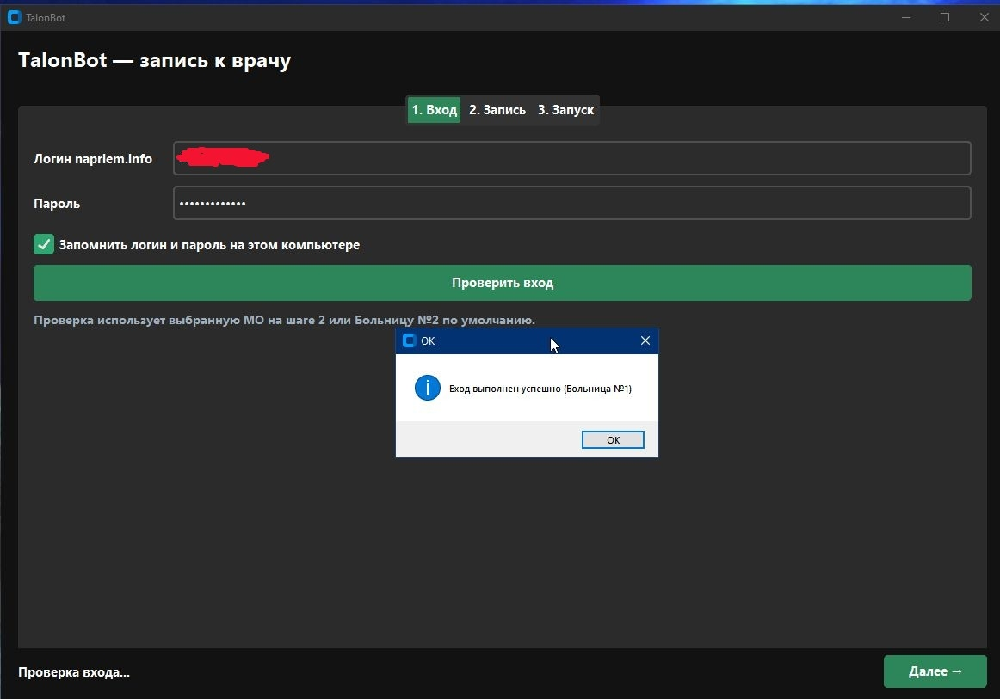
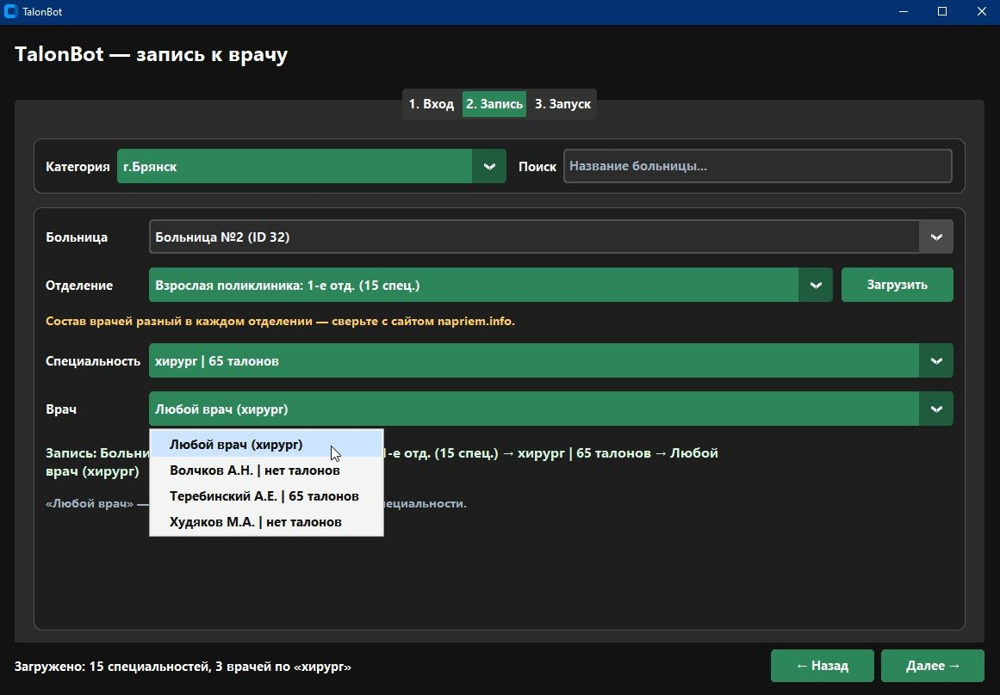
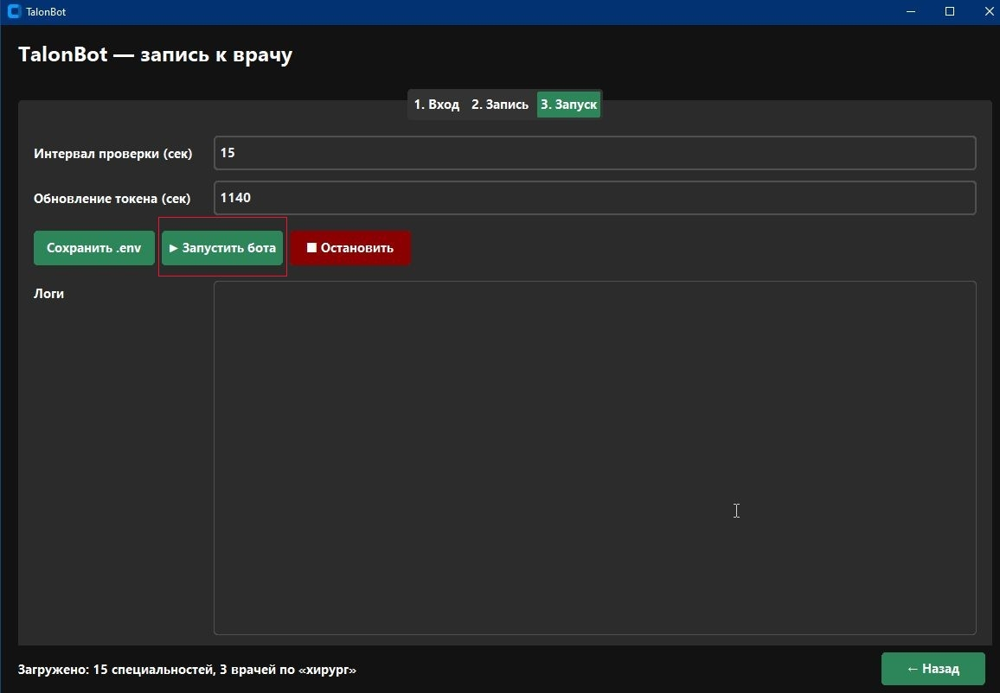
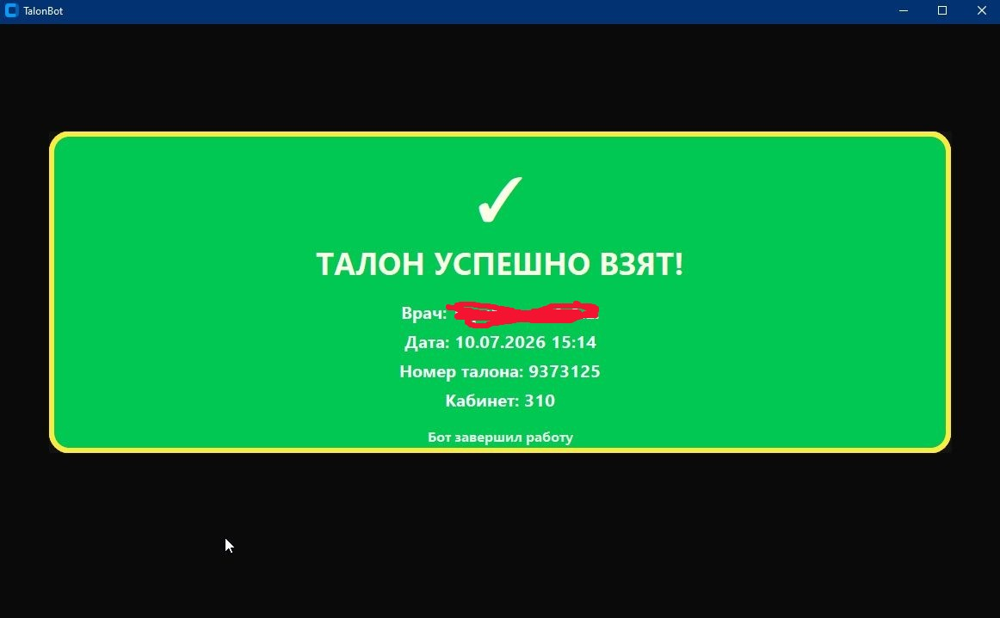

<p align="center">
  
</p>

<h1 align="center">🏥 TalonBot</h1>

<p align="center">
  <strong>Автозапись к врачу на napriem.info</strong><br>
  Desktop · Windows · Брянск и область · коммерческий pet-project
</p>

<p align="center">
  
  
  
  
</p>

<p align="center">
  
  
  
  
</p>

---

## 🩺 О проекте

**TalonBot** — мой личный коммерческий проект: desktop-приложение для жителей **Брянска и Брянской области**, которое мониторит официальный портал [napriem.info](https://napriem.info) и **автоматически пытается записать на талон**, когда появляется свободное окно.

Идея родилась из реальной боли: редкие талоны к узким специалистам исчезают за секунды. Вместо ручного F5 — фоновый бот со звуковым уведомлением при успехе.

> 📌 Этот репозиторий — **публичная витрина** проекта. Исходный код приложения **не распространяется бесплатно** и не является open-source.

---

## ✨ Возможности

| | Функция | Описание |
|:-:|---------|----------|
| 🖥️ | **Графический лаунчер** | Три шага: вход → выбор врача → запуск. Без ручного редактирования конфигов |
| 🔁 | **Автомониторинг** | Периодическая проверка свободных талонов на выбранную специальность |
| ⚡ | **Автозапись** | Попытка записи сразу при появлении окна |
| 🔔 | **Уведомление** | Звук Windows + зелёный баннер «ТАЛОН УСПЕШНО ВЗЯТ» |
| 🏥 | **Кэш МО** | Более 45 медорганизаций региона в базе |
| 🔑 | **Лицензия на 1 ПК** | Персональный ключ после покупки |

---

## 🔄 Как это работает

```
┌─────────────┐     ┌──────────────┐     ┌─────────────────┐
│  🖥️ Лаунчер │ ──▶ │ 🔐 Вход      │ ──▶ │ 🏥 Выбор врача  │
│  (GUI)      │     │ napriem.info │     │ в интерфейсе    │
└─────────────┘     └──────────────┘     └────────┬────────┘
                                                  │
                                                  ▼
┌─────────────┐     ┌──────────────┐     ┌─────────────────┐
│ 🔔 Звук +   │ ◀── │ ✅ Запись    │ ◀── │ 🔁 Мониторинг   │
│ 🎉 баннер   │     │  на талон    │     │ талонов (15 с)  │
└─────────────┘     └──────────────┘     └─────────────────┘
```

Подробнее — в [docs/ARCHITECTURE.md](docs/ARCHITECTURE.md) *(без раскрытия проприетарной логики)*.

---

## 📸 Скриншоты

<p align="center">
  
  &nbsp;
  
</p>

<p align="center">
  <sub><b>1. Вход</b> — логин и проверка авторизации &nbsp;·&nbsp; <b>2. Запись</b> — больница, отделение, специальность, врач</sub>
</p>

<p align="center">
  
  &nbsp;
  
</p>

<p align="center">
  <sub><b>3. Запуск</b> — интервал опроса и логи &nbsp;·&nbsp; <b>4. Успех</b> — звук + баннер «ТАЛОН УСПЕШНО ВЗЯТ»</sub>
</p>

---

## 🛠 Стек технологий

<p align="center">
  
  
  
  
  
  
</p>

| Слой | Технологии |
|------|------------|
| 🎨 UI | Python, CustomTkinter |
| 🌐 HTTP / API | requests, интеграция с napriem.info |
| 🔐 Авторизация | Сессия пользователя на официальном портале |
| 🔑 Лицензирование | Привязка к hardware ID, персональные ключи |
| 📦 Сборка | PowerShell-архив для покупателей |

---

## 🛒 Купить

Программа распространяется **только после оплаты** — архив + персональный лицензионный ключ.

<p align="center">
  <a href="https://www.avito.ru/bryansk/predlozheniya_uslug/avtozapis_k_vrachu_napriem.info_talonbot_8134981995">
    
  </a>
</p>

| Шаг | Действие |
|:---:|----------|
| 1️⃣ | Оплата на Avito |
| 2️⃣ | Распаковка архива и установка |
| 3️⃣ | Код компьютера → персональный ключ |
| 4️⃣ | Вход → Запись → Запуск бота |

---

## 🔒 Что **не** в этом репозитории

| 🚫 Не публикуется | Почему |
|-------------------|--------|
| Исходники бота и API-клиента | Коммерческий продукт |
| Генератор лицензий | Только у автора |
| Секреты и конфиги | Безопасность |
| Инструкции продавца | Внутренняя документация |

> ⚠️ Скачать репозиторий с GitHub **нельзя использовать как готовую программу** — здесь нет исполняемого кода.

---

## 👤 Автор

**Андрей Быченков** — автор и разработчик TalonBot.

- 🐙 GitHub: [@AndreyBychenkow](https://github.com/AndreyBychenkow)
- 💬 Покупка и вопросы — [Avito](https://www.avito.ru/bryansk/predlozheniya_uslug/avtozapis_k_vrachu_napriem.info_talonbot_8134981995)

---

## 📄 Лицензия

**Proprietary / All Rights Reserved.** См. [LICENSE](LICENSE).

🚫 Запрещено: копирование, модификация, распространение и коммерческое использование без письменного разрешения автора.

---

<p align="center">
  
  <br>
  <sub><b>TalonBot</b> · napriem.info · Брянская область · 2026</sub>
</p>
